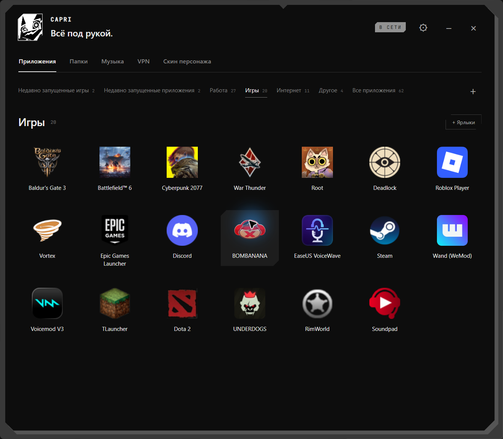
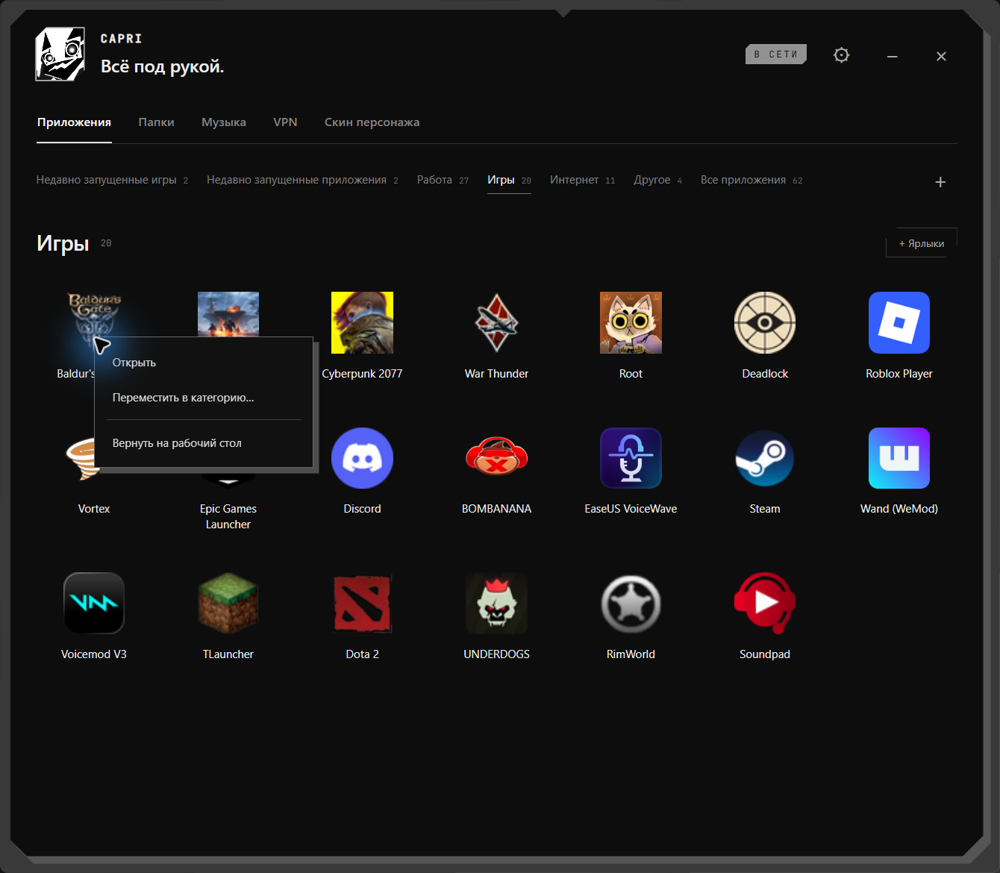
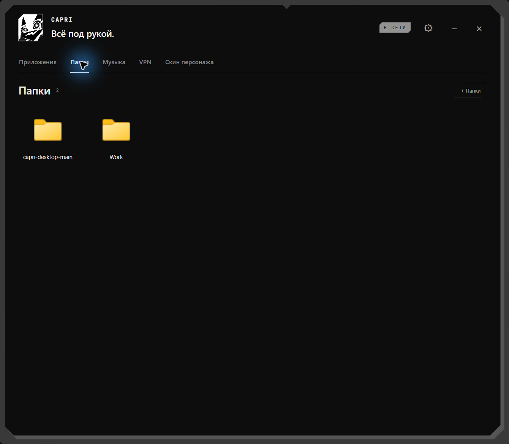
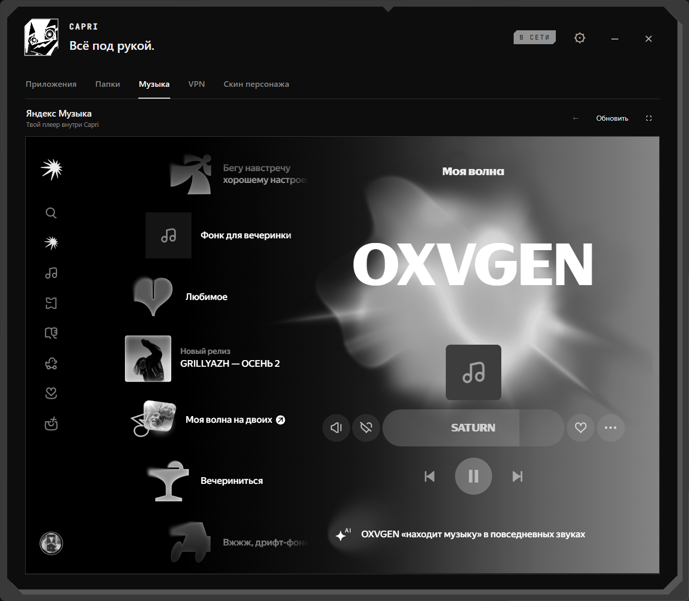
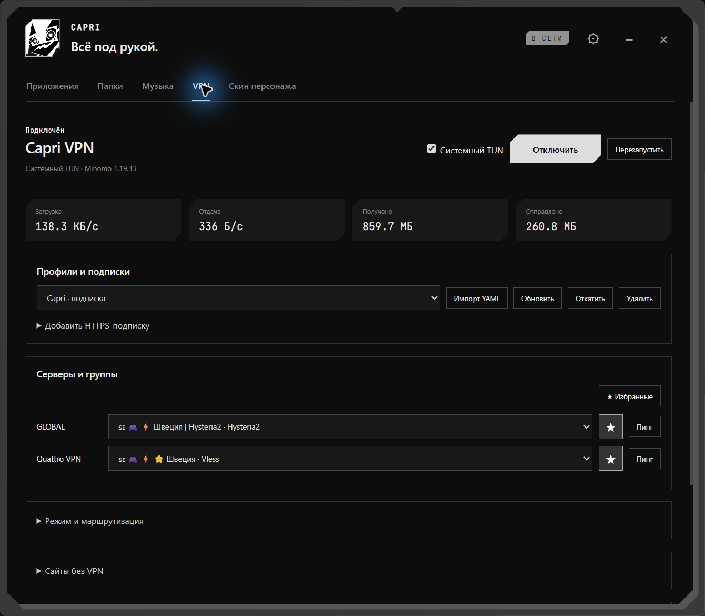

# Руководство Capri Desktop 0.6.11

[Обзор проекта](README.md) · [Новые скриншоты](docs/SCREENSHOTS.md) · [Документация](docs/README.md)

## Два меню

**Правая кнопка по персонажу** открывает основное окно по центру экрана: приложения, папки, музыка, VPN и скины. Окно можно свернуть; оно отображается в панели задач. Шестерёнка открывает настройки, доступные также через значок в трее.

**Средняя кнопка — нажатие колёсика — по Capri** открывает быстрое меню у курсора. Повторное нажатие или Escape закрывает его. Меню подстраивается под содержимое, длинные списки прокручиваются отдельно. Здесь находятся VPN и избранное, Zapret, музыка и её управление, закрепление на окне и сон.

VPN, Zapret, музыка и персонаж имеют независимые состояния занятости. Запуск Zapret не означает подключение VPN.

## Приложения

1. Выбери категорию: «Работа», «Игры», «Интернет», «Другое» или создай свою кнопкой **+**.
2. Перетащи `.lnk` или `.url` на категорию, в сетку или добавь через **+ Ярлыки**.
3. Нажми значок, чтобы запустить приложение.

Ярлык можно перетащить **прямо на Capri**: она предложит категорию по названию. Исправь выбор при необходимости и нажми **Забрать в меню**. До подтверждения файлы остаются на месте; отмена не переносит их.

После успешного сохранения ярлык с рабочего стола убирается в библиотеку. Само приложение и его данные не перемещаются. Ярлыки из других папок копируются с сохранением исходника. Если Windows запрещает удалить ярлык с общего рабочего стола, он останется там, а Capri сообщит об этом.

Чтобы изменить порядок, перетащи значок к левой или правой стороне другого значка. Порядок сохраняется после перезапуска. Перетаскивание на название категории переносит приложение в неё. Вкладки **Недавно запущенные игры** и **Недавно запущенные приложения** сортируются по времени запуска через Capri.

Правый клик по значку открывает запуск, смену категории и возврат на рабочий стол. Постоянных кнопок управления под каждым приложением нет. При возврате в защищённый общий рабочий стол может использоваться личный рабочий стол; библиотечная копия удаляется после успешного восстановления.

Оригинальные иконки извлекаются через Electron и Windows Shell, включая ресурсы EXE/DLL и индекс ресурса из ярлыка. Если приложение или источник иконки удалены либо Windows не умеет декодировать его, возможен резервный значок.

## Папки

Перетащи каталог или `.lnk`, ведущий к каталогу, во вкладку **Папки** либо нажми **+ Папки**. Нажатие значка открывает каталог в Проводнике; порядок меняется перетаскиванием.

Capri сохраняет **только ссылку**. Каталоги и их содержимое не перемещаются, а **Убрать из меню** не удаляет исходную папку или её ярлык. Если каталог перенесён, удалён или находится на отключённом диске, добавь актуальный путь заново.

## Музыка

Вкладка **Музыка** открывает сайт Яндекс Музыки внутри Capri с чёрно-белым оформлением. Войди на самом сайте: сессия сохраняется после перезапуска. Над плеером есть кнопки **Назад**, **Обновить** и изменения размера.

В быстром меню **Музыка** открывает вкладку; ниже находятся предыдущий трек, воспроизведение/пауза, следующий трек и громкость. Сначала загрузи плеер и выбери доступный трек. Управление использует возможности встроенной страницы, а не стороннего музыкального приложения.

В свободное время персонаж реагирует на воспроизведение, покачивая головой и ногами, даже при скрытом основном окне. Это не анализ музыкального ритма. Доступность треков зависит от Яндекса, аккаунта и сети; показ страницы сам по себе не доказывает доступность аудио.

## Персонаж и скины

Во вкладке **Скин персонажа** доступны NOIR и ORIGINAL; выбор сохраняется. NOIR использует светлые детали, чёрные контуры и соответствующие цвета интро и иконок.

Перетащи Capri на подходящий верхний край окна, чтобы посадить её. **Остаться здесь** закрепляет её; **Открепить от окна** возвращает свободное поведение. На окне она болтает ногами, сообщение располагается сбоку.

**Подремать** включает ручной сон лёжа с Zzz; пункт меняется на **Проснуться**. Уход курсора, музыка или очередное рабочее событие не отменяют ручной отдых. Для пробуждения используй **Проснуться**; важные запросы внимания могут прервать отдых. Автоматический сон от бездействия обрабатывается отдельно.

Левая кнопка взаимодействует с персонажем; `Ctrl+Alt+C` прячет её в маленькую иконку и возвращает обратно. Размер, поведение, язык и звук настраиваются через шестерёнку и трей.

## VPN: профиль, группа и сервер

1. Импортируй YAML или добавь **HTTPS-подписку** с названием и ссылкой своего провайдера.
2. Выбери активный профиль и нужный режим.
3. Выбери сервер в соответствующей группе и подключись. **☆** сохраняет локацию в избранное; **★ Избранные** фильтрует список.

| Элемент | Назначение |
| --- | --- |
| Профиль | Конфигурация и серверы из файла или подписки |
| `GLOBAL` | Выбор сервера для глобального режима |
| Группы провайдера | Выбор серверов для правил активного профиля |
| По правилам | Правила профиля и локальная маршрутизация |
| Глобальный | Выбранный GLOBAL с учётом прямых исключений |
| Прямой | Соединение без выбранного прокси |

Последняя локация сохраняется. При смене сервера Capri закрывает старые соединения управляемого ядра, чтобы приложения создали их через новый сервер. Это кратко прерывает сетевые сессии. Для прежней службы без поддержки очистки соединений используется автоматическое переподключение.

Без TUN работает локальный HTTP/SOCKS-прокси; системный прокси Windows автоматически не включается. Используй показанный адрес в нужном приложении, если нужен именно прокси-режим.

### Системный TUN

Открой **VPN → Служба и диагностика → Установить / обновить службу**, подтверди нативный запрос UAC, затем настрой и включи TUN. Основное приложение Electron не запускается от администратора. Доступны System/GVisor/Mixed, интерфейс, маршруты, MTU и DNS в пределах возможностей включённого Mihomo.

Полная проверка системных маршрутов, DNS-утечек, сна, смены сети и аварийного завершения **не завершена для этой сборки**. Реальное ядро без TUN и исторические ограниченные проверки создания адаптера не подтверждают всю матрицу. Полноценный kill switch не заявляется. Не используй несколько системных VPN/TUN одновременно как тестовую среду: их маршруты могут мешать друг другу.

### Сайты без VPN

В **VPN → Сайты без VPN** добавляй домены или HTTP/HTTPS-ссылки, по одному на строку. Сохрани исключения: эти домены и поддомены пойдут напрямую. Исключения работают и в глобальном режиме; пустой список отключает их. Путь страницы и порт не сужают исключение до одной страницы.

Музыка, вход и статические ресурсы могут использовать разные домены. Для Яндекс Музыки Capri также учитывает связанные домены плеера и аудио. Это не гарантирует доступность при ограничениях провайдера, DNS или другой работающей VPN-программы.

Подробнее: [использование](docs/vpn/USAGE.md), [архитектура](docs/vpn/ARCHITECTURE.md), [отчёт](docs/vpn/TEST-REPORT.md), [ручная приёмка TUN](docs/vpn/WINDOWS-TUN-TESTS.md).

## Zapret

Нажми колёсико по Capri и выбери **Запустить Zapret**. При первом использовании или потере сохранённой папки появится выбор каталога. Укажи свою распакованную копию Zapret и выбери стратегию `.bat`.

Последняя успешно запущенная стратегия сохраняется. В меню можно выбрать другую или остановить запущенную Capri. Привилегированный запуск требует подтверждения UAC. Сам Zapret и его готовые стратегии не поставляются в этом репозитории.

Zapret не включает VPN. Capri не считает чужой процесс с таким же именем своим и не завершает все процессы по имени. Подробный вывод batch-файлов не встраивается в быстрое меню.

## Codex

Выбери установку хуков в настройках либо выполни `npm run hooks:install`. Capri добавляется в `~/.codex/hooks.json` с сохранением существующих хуков и резервной копией; поддерживается `CODEX_HOME`. После установки начни новую сессию Codex. Удаление: `npm run hooks:uninstall`.

Capri реагирует на работу инструментов, ошибки, завершение, запросы разрешения и вопросы. Вопрос агента не исчезает только потому, что тот продолжил независимую работу. События поступают на локальный HTTP-мост; отдельный API-ключ Capri не нужен.

## Данные и сборка

Порядок `npm ci → npm run vpn:prepare → npm test → npm start` и сборка Windows x64 описаны в [README](README.md#из-исходников). Установщик — `dist/Capri-Setup-0.6.11.exe`, без цифровой подписи.

Настройки и библиотека находятся в пользовательской папке данных Capri. Библиотечные ярлыки — в `launcher/shortcuts/`. Профили и ссылки подписок защищаются Windows DPAPI, но работающему ядру нужна временная читаемая конфигурация. Не публикуй папку данных, runtime-конфигурации или токены подписок.

Авторство, лицензии и права на изображения: [README](README.md#авторы-и-лицензии), [THIRD-PARTY.md](THIRD-PARTY.md).
