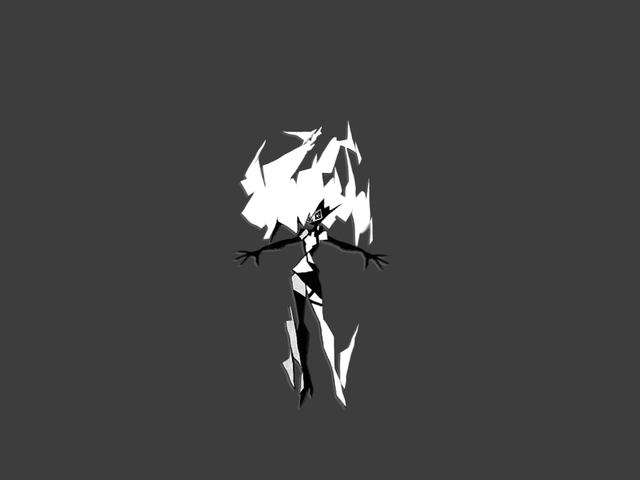
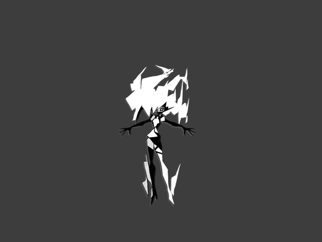
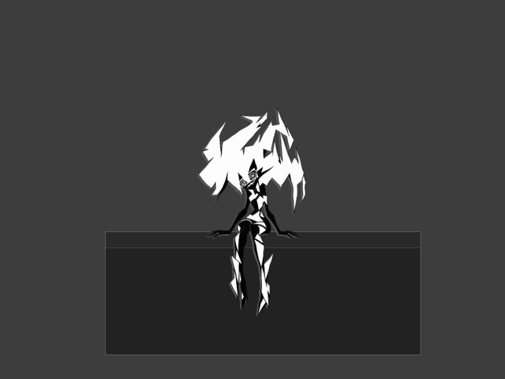
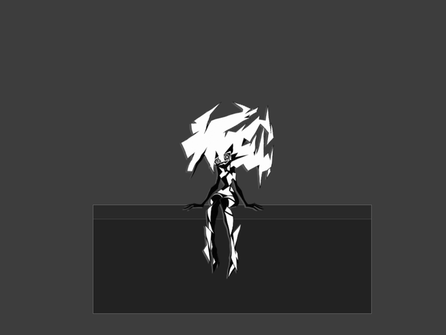

# Ситуационные реакции Capri

Версия **0.6.12**. Эти жесты и реплики входят в приложение.

Новые реакции используют существующий WebGL-риг и короткие листы экспозиций: отдельные видеоролики или новые изображения не требуются.

| Ситуация | Реакция | Ограничение |
| --- | --- | --- |
| Приложение успешно запущено через библиотеку | Два кивка и одна из четырёх реплик с названием приложения | Не чаще раза в 12 секунд |
| Ошибка запуска приложения через библиотеку | Озадаченные наклоны головы; стоя — небольшой жест руками, короткая подсказка | Не чаще раза в 18 секунд; подробности ошибки в реплику не копируются |
| Пользователь нажал «Проснуться» или разбудил спящую Capri кликом | Потягивание стоя; на окне — разминка шеи с сохранением сидячей позы | Не чаще раза в 30 секунд |
| Встроенная музыка поставлена на паузу после минимум трёх секунд воспроизведения | Спокойный наклон головы и реплика без звуков печати | Не чаще раза в две минуты; начальное состояние плеера не считается паузой |

Между любыми двумя новыми реакциями выдерживается минимум пять секунд. Обычные реакции не прерывают работу Codex, вопрос, важную реплику, жест, перетаскивание или ручной сон. В скрытом состоянии и игровом режиме они отбрасываются, а не откладываются на выход из игры. При уменьшении движения сохраняются штатные ограничения рендера.

Во время игры голос использует временное подавление, не меняющее сохранённую громкость и настройку «без звука». Уже запущенные и запланированные звуковые источники останавливаются. Обычные реплики не накапливаются. Ожидающий вопрос Codex сохраняется и после выхода из игры появляется без старого звукового сигнала; если на него ответили во время игры, сообщение не возвращается.

## Новые жесты в движении

GIF записаны из настоящего WebGL-рендера сборки 0.6.12 на нейтральной сцене. Жесты повторяются для просмотра; в приложении их запускают события из таблицы выше.

| Успешный запуск | Ошибка запуска |
| --- | --- |
|  |  |

| Проснуться стоя | Проснуться сидя |
| --- | --- |
|  |  |

Проверки: `node --test scripts/test-companion-reactions.cjs` и `node tools/test-companion-reactions-ui.cjs` (для второй проверки нужен Playwright). Они используют временную папку данных, а не установленную Capri и её действующие сетевые подключения.

## Выполненные проверки

- Восемь проверок прошли при совместном запуске `scripts/test-companion-reactions.cjs`, `scripts/test-pose-art.cjs` и `scripts/test-codex-question.cjs`: события, ограничения частоты, отсутствие реакций во сне и игре, регистрация сидячей позы, остановка звуковых источников и сохранение сессий Codex.
- Реальный Electron/WebGL-тест `tools/test-companion-reactions-ui.cjs` прошёл: кивок меняет альфа-пиксели на GPU; ошибка запуска приходит через настоящий IPC библиотеки; пробуждение, ошибка и пауза музыки сохраняют сидячий рисунок; ручной сон переживает обычную работу Codex во время игры.
- Тот же UI-тест проверил остановку настоящего запланированного WebAudio-источника, подавление устаревших реплик, тихое восстановление ожидающего вопроса и отсутствие возвращающегося сообщения после ответа во время игры.
- Проверены три гонки загрузки в настоящем Electron: игра завершается или запускается, пока загрузка изображения удерживается до установки обработчиков; новый игровой статус приходит во время задержанного повторного чтения конфигурации. Renderer и нативные видимость/звук совпадают с последним статусом. После установки обработчиков Capri повторно читает актуальное состояние, а счётчик ревизий не позволяет старому ответу перекрыть более новое событие.
- Для проверки событийных реакций в тестовой сцене отключены автономные жесты от курсора и бездействия. Они могут законно отклонить низкоприоритетную реакцию в обычной работе; production-ограничения для активного жеста, сна, игры и важных сообщений остаются включены.
- В UI-проверке игровой режим включается тестовой командой; это проверка renderer, а не доказательство распознавания конкретной игры. DirectX, полноэкранные режимы настоящих игр и Alt+Tab вручную здесь не проверялись. Настоящее воспроизведение Яндекс Музыки не запускалось; событие паузы подаётся через существующий IPC.
