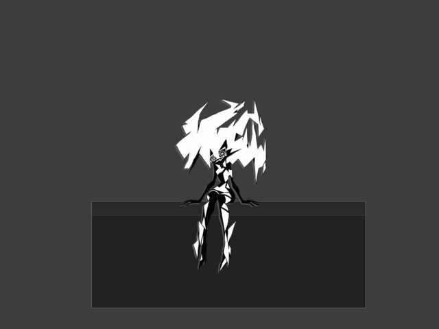
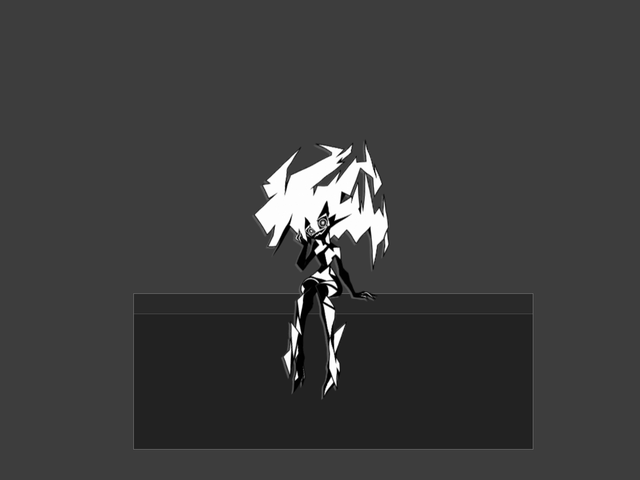
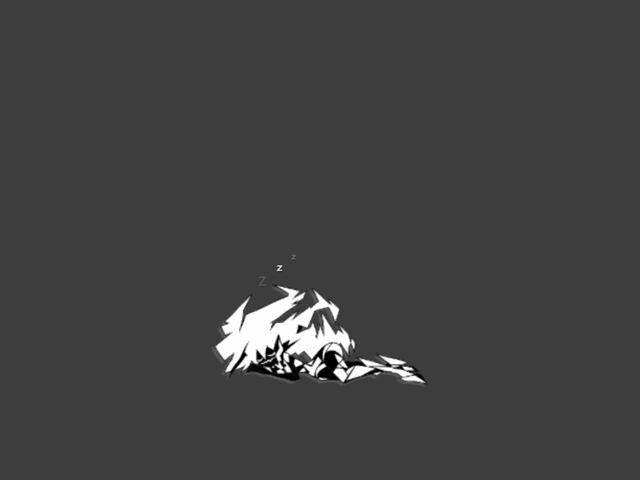
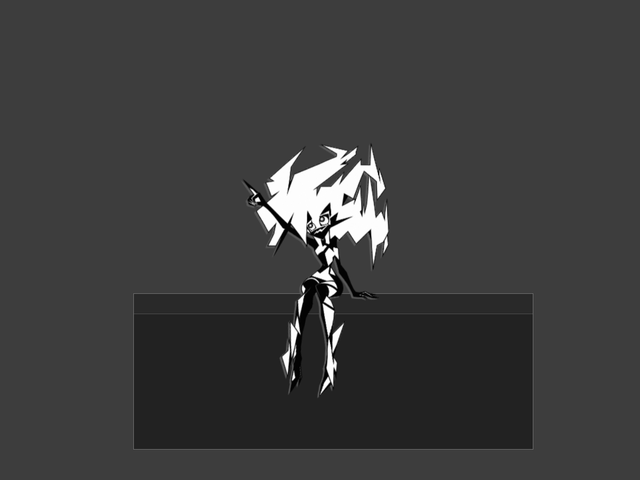
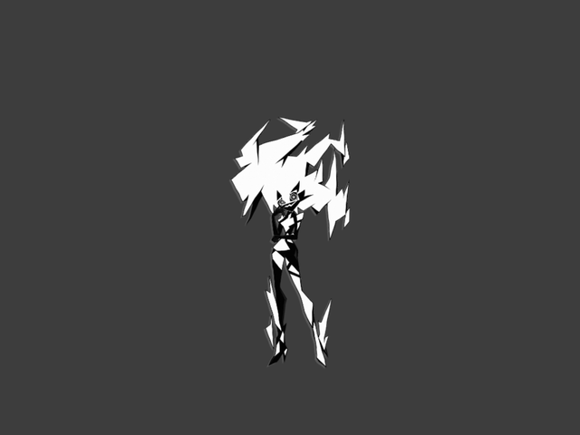
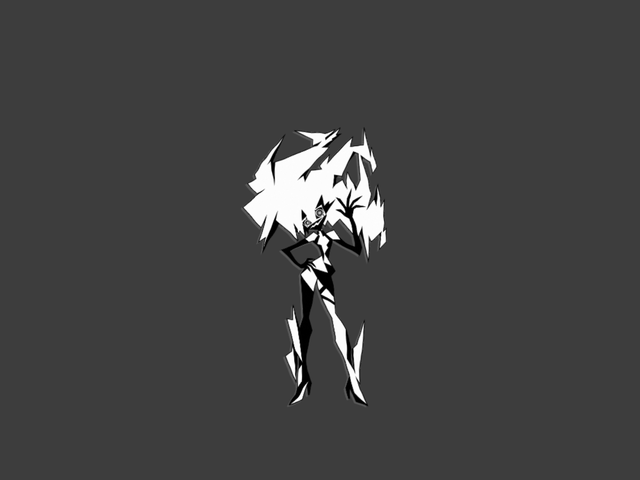

# Позы и анимации Capri NOIR

[README](../README.md) · [Скриншоты интерфейса](SCREENSHOTS.md) · [Техническое описание](NOIR-ANIMATIONS.md)

Здесь показаны позы, уже работающие в Capri 0.6.11. GIF записаны заново 27 октября 2026 года из настоящего WebGL-рендера упакованного приложения. Они проигрываются прямо на GitHub и повторяются по кругу. Это демонстрации на нейтральной сцене с условным краем окна; установленная Capri, её настройки, VPN и музыка при записи не менялись. Новые движения для этой публикации в приложение не добавлялись.

## Сидит и болтает ногами

Когда Capri сидит на краю окна, голени двигаются независимо, а корпус остаётся на опоре.



## Слушает музыку

Реакция сидящего персонажа на воспроизведение во встроенном плеере: рука у головы, покачивания головы и ног. Это цикл анимации, а не синхронизация с BPM трека.



## Дремлет

Сон лёжа с поднимающимися буквами Zzz. В приложении его включает «Подремать», после чего пункт меняется на «Проснуться».



## Смотрит на звезду

Сидячая версия жеста вверх сохраняет позу на краю окна.



## Ждёт ответа

Стоящая Capri принимает задумчивую позу, когда ждёт ответа или разрешения пользователя.



## Приветствует

Жест приветствия используется при подключении хуков, завершении работы и некоторых взаимодействиях с персонажем. В этом превью жест повторяется для просмотра.



## Исходные рисунки

Прозрачные PNG уже входят в репозиторий и установщик. Нажатие на название открывает исходный файл; движение задают код анимации и WebGL-риг.

| Поза | Исходник |
| --- | --- |
| Сидение | [seated.png](../assets/skins/mono/poses/seated.png) |
| Музыка | [music-seated.png](../assets/skins/mono/poses/music-seated.png) |
| Сон лёжа | [sleep-lying.png](../assets/skins/mono/poses/sleep-lying.png) |
| Жест к звезде | [gaze-seated.png](../assets/skins/mono/poses/gaze-seated.png) |
| Ожидание | [thinking.png](../assets/skins/mono/poses/thinking.png) |
| Приветствие | [wave.png](../assets/skins/mono/poses/wave.png) |

Выбор рисунка: [pose-art.js](../src/renderer/js/pose-art.js). Циклы и жесты: [acting.js](../src/renderer/js/acting.js). Применение к персонажу: [capri.js](../src/renderer/js/capri.js). Рендер: [sprite.js](../src/renderer/js/sprite.js).

## Повторная запись

Нужны подготовленная сборка `dist/win-unpacked/Capri.exe` версии 0.6.11, Playwright и Python с Pillow. Укажи пути к установленным зависимостям в `CAPRI_PLAYWRIGHT_PATH` и `CAPRI_PYTHON`, затем выполни:

```powershell
node tools/capture-animation-gallery.cjs
```

Скрипт создаёт отдельную временную папку данных, записывает каждый пример и закрывает только свой процесс. Сначала сохраняются PNG-кадры рендера, затем они кодируются в GIF размером 640×480 с частотой 10 кадров в секунду. Настройки уменьшения движения в самой Capri отключают соответствующие циклы; GIF показывают обычный режим.
