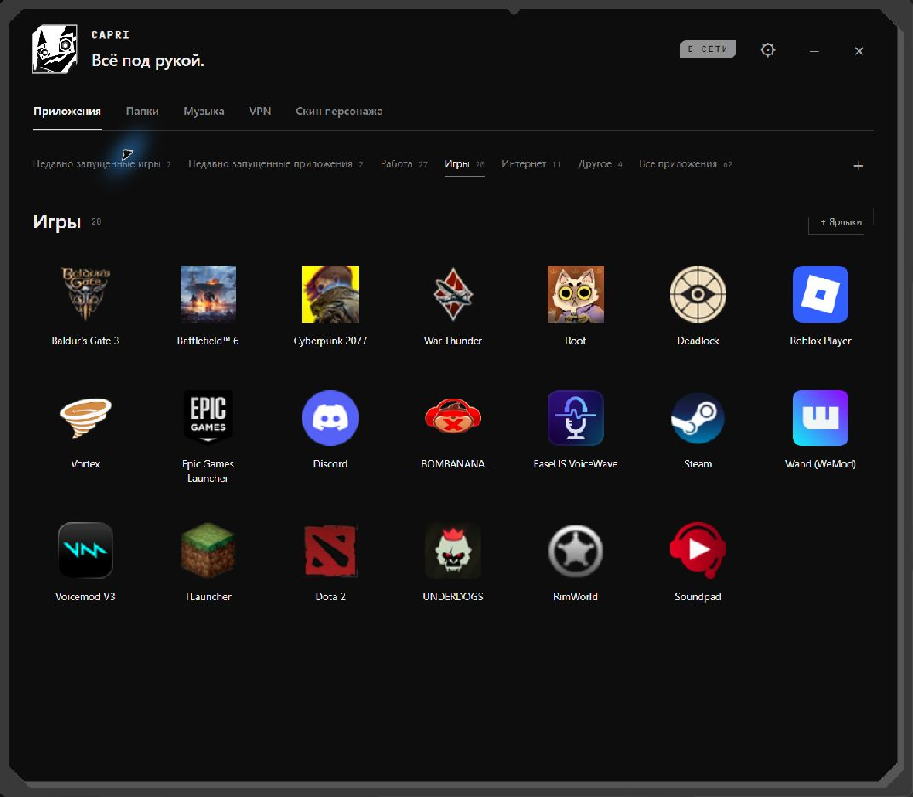
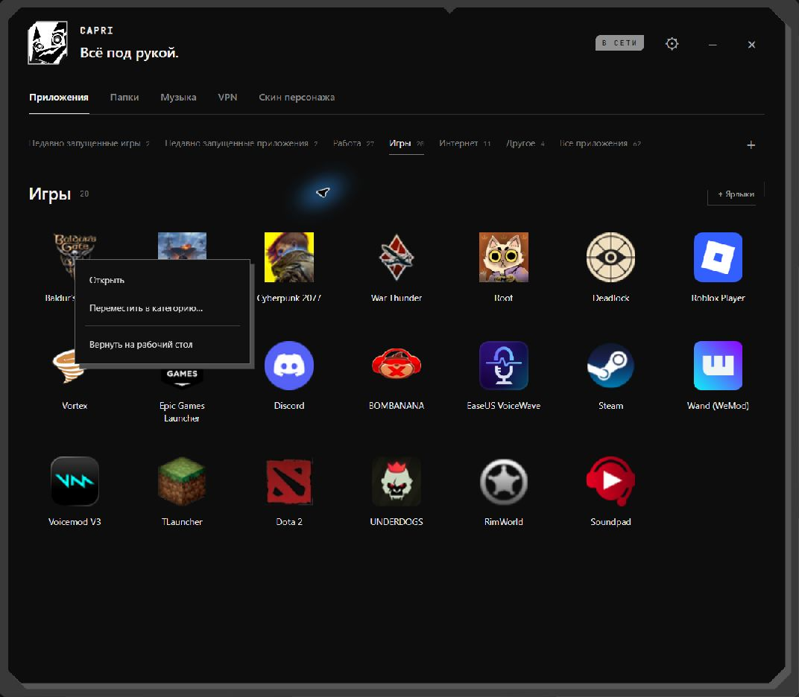
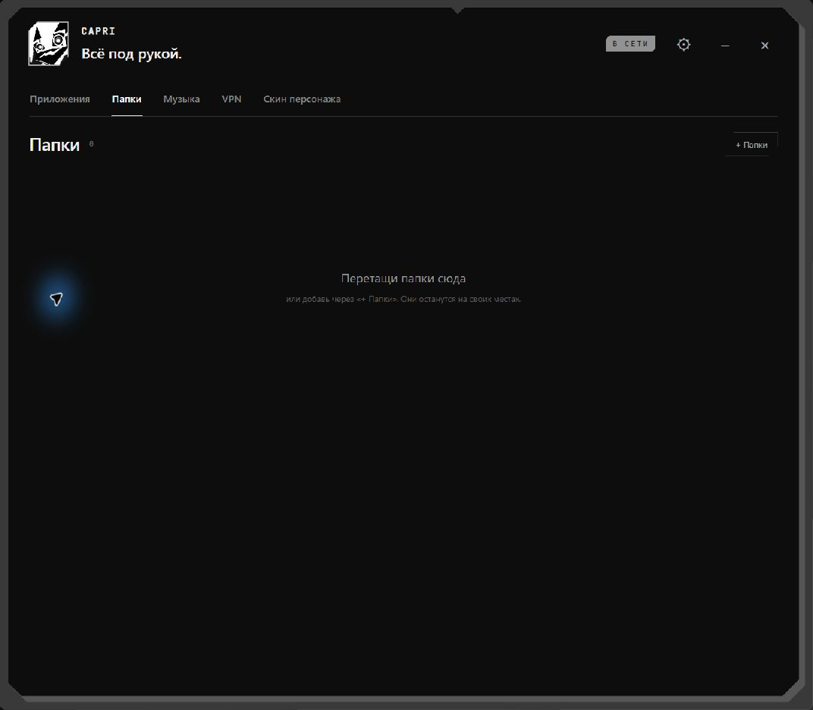
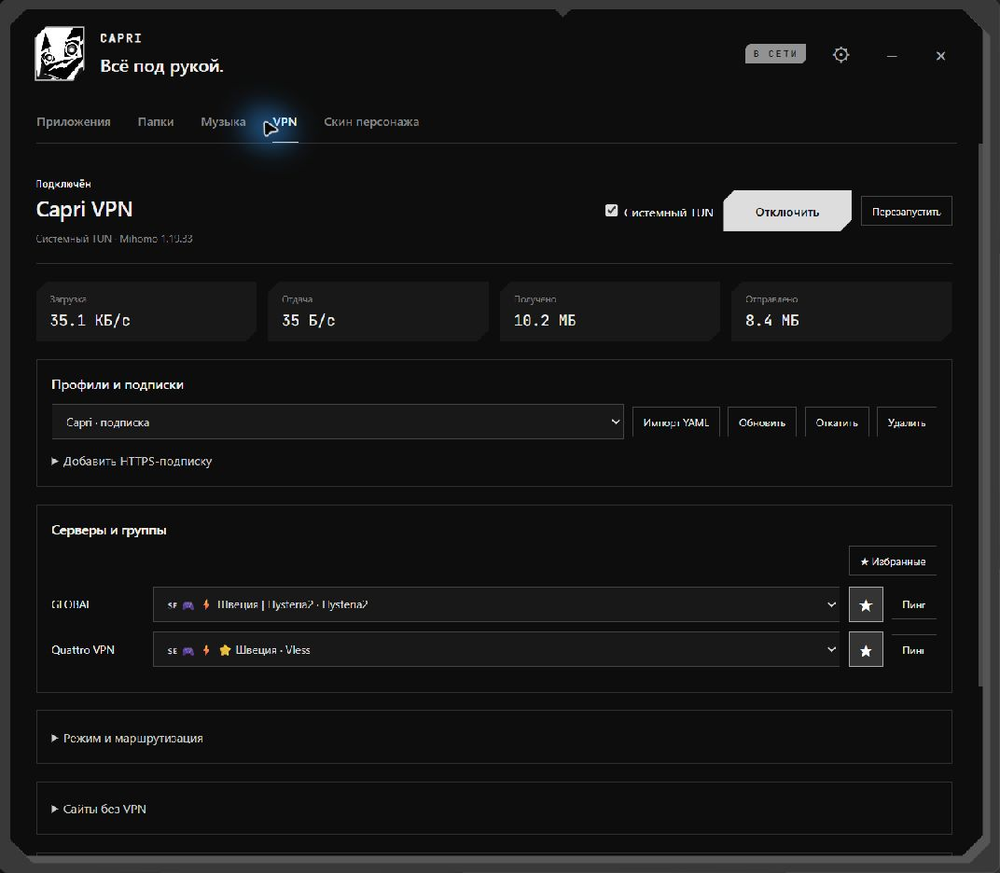
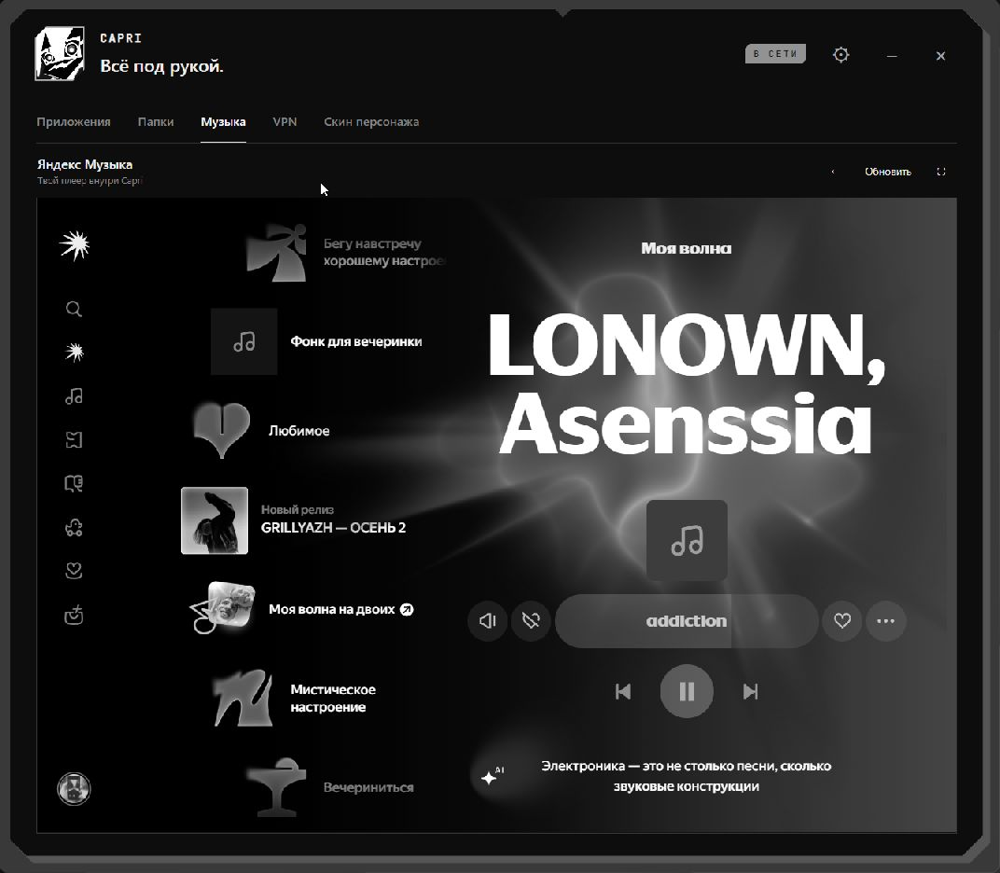

# Новые скриншоты · Capri 0.6.11

[README](../README.md) · [Руководство](../README.ru.md) · [Документация](README.md)

Снимки сделаны 27 октября 2026 года в установленной и запущенной Capri на Windows. Каждый кадр ограничен окном приложения: рабочий стол и другие программы в галерею не включены. Исходные кадры сохранены без подмены интерфейса и находятся в `docs/screenshots/0.6.11/`. Настройки, VPN и воспроизведение музыки при съёмке не переключались; URL подписок и ключи в кадры не попали.

## Приложения

Оригинальные значки с подписями, категории и последние запуски. Порядок обычной сетки меняется перетаскиванием.

### Правый клик по значку

Запуск, смена категории и возврат ярлыка доступны в контекстном меню.

## Папки

Отдельная библиотека ссылок на каталоги. Удаление из меню сохраняет исходные папки и файлы.

На снимке — пустая библиотека установленного приложения, готовая к добавлению папок.

## VPN

Профили, серверы, избранное, статистика и настройки Mihomo. Скриншот интерфейса не доказывает системную TUN-маршрутизацию или отсутствие DNS-утечек.

## Яндекс Музыка

Встроенная вкладка с оформлением Capri. Доступность воспроизведения зависит от сервиса, аккаунта и сети.

## Скины

NOIR и ORIGINAL выбираются в основном окне и сохраняются после перезапуска.

Быстрое меню открывается средней кнопкой по персонажу; его управление описано в [руководстве](../README.ru.md#два-меню). Отдельного снимка этого служебного окна здесь нет: инструмент захвата Windows не предоставил его как доступное окно.
