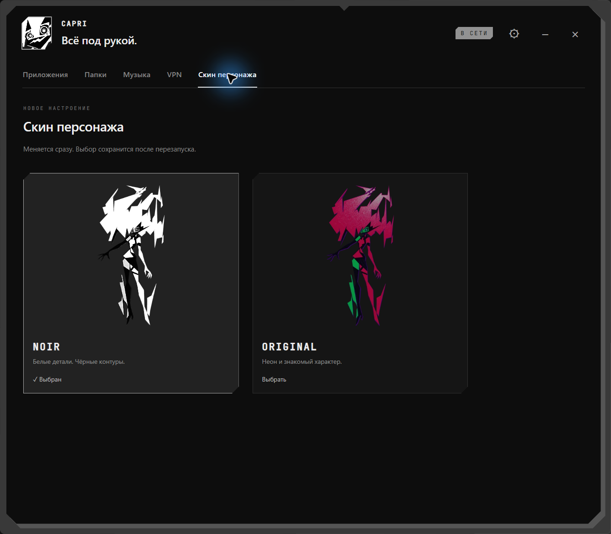
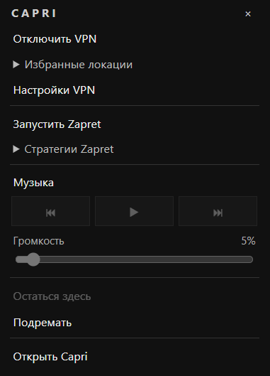

# Новые скриншоты · Capri 0.6.11

[README](../README.md) · [Документация](README.md)

Снимки сделаны 27 октября 2026 года в установленной и запущенной Capri на Windows. Каждый кадр ограничен окном приложения: рабочий стол и другие программы в галерею не включены. Шесть вкладок пересняты через Alt+Print Screen и сохранены напрямую из буфера Windows в PNG размером **1340×1170**, без уменьшения и JPEG-сжатия. Кадры находятся в `docs/screenshots/0.6.11/`. VPN и воспроизведение музыки при съёмке не переключались; URL подписок и ключи в кадры не попали.

## Приложения

Оригинальные значки с подписями, категории и последние запуски. Порядок обычной сетки меняется перетаскиванием.

### Правый клик по значку

Запуск, смена категории и возврат ярлыка доступны в контекстном меню.

## Папки

Отдельная библиотека ссылок на каталоги. Удаление из меню сохраняет исходные папки и файлы.

На снимке — библиотека установленного приложения с добавленными папками.

## VPN

Профили, серверы, избранное, статистика и настройки Mihomo. Скриншот интерфейса не доказывает системную TUN-маршрутизацию или отсутствие DNS-утечек.

## Яндекс Музыка

Встроенная вкладка с оформлением Capri. Доступность воспроизведения зависит от сервиса, аккаунта и сети.

## Скины

NOIR и ORIGINAL выбираются в основном окне и сохраняются после перезапуска.

## Быстрое меню

Открывается средней кнопкой по персонажу. Здесь находятся VPN, избранные локации, Zapret, музыка, закрепление и сон. Скриншот предоставлен пользователем и добавлен без изменений.

## Позы и анимации

[Посмотреть позы и проигрываемые GIF](POSES-AND-ANIMATIONS.md): сидение, музыка, сон с Zzz, взгляд на звезду, ожидание ответа и приветствие. Эти демонстрации отдельно записаны из рендера Capri на нейтральном фоне.
